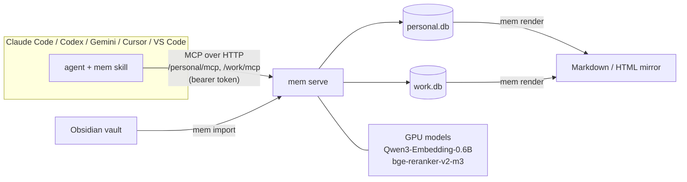

# Architecture

How mem is put together: what a store holds, what happens on `remember` and `recall`, and where each
piece lives in `src/mem/`. For the reasoning behind individual choices, see
[decisions/](decisions/); for numbers, [benchmarks.md](benchmarks.md).

## The pieces

- **One server, two stores.** `mem serve` (a systemd user service, `127.0.0.1:8765` by default) mounts
  the `personal` and `work` stores and exposes each as its own MCP server (`mem-personal`,
  `mem-work`), with the same six tools: `recall`, `get`, `remember`, `link`, `subjects`, `forget`
  (`src/mem/contracts/mcp_tools.json` is the frozen schema). Only `mem serve` loads models; other
  commands that need them borrow the server's over a local endpoint (`models_http.py`).
- **A store is one SQLite file** (`~/.local/share/mem/<scope>.db`, WAL mode) with FTS5 for keywords and
  [sqlite-vec](https://github.com/asg017/sqlite-vec) for vectors. One process writes it; a second
  machine talks to the server instead of syncing files ([multi-machine.md](multi-machine.md)).
- **The skill** (`skills/mem/SKILL.md`) is the other half of the product: it tells the agent when to
  recall, what is worth saving and how to word it. `mem setup` installs it next to the MCP servers.

## Data model

Everything is a **node** in a typed graph (`schema/migrations/0001_schema_v2.sql`):

| Table | Holds |
|---|---|
| `nodes` | `kind` = `memory` (one atomic fact), `entity` (person, project, organisation, place, topic), `note` (an imported vault note) or `tag`; with `valid_from` / `valid_to` and a `status` |
| `edges`, `rels` | typed edges and their vocabulary: `about`, `supersedes`, `duplicate_of`, `relates_to`, `same_as`, … |
| `chunks`, `chunks_fts`, `vec_<fingerprint>` | the searchable text of each node, its FTS5 index, and its vectors (one table per embedder fingerprint) |
| `aliases`, `aliases_tri` | names and aliases of entities, with a trigram index for fuzzy lookup |
| `props`, `source_files`, `link_occurrences` | vault frontmatter, imported files, and where wikilinks occur |
| `events` | an append-only log of every write |
| `meta` | schema version, the active vector table, and the fitted **gate** |

Facts are never overwritten. A changed fact gets a new memory and a `supersedes` edge; the old one
closes its `valid_to` and stays as history, so `recall(as_of=…)` and `include_history` can answer "what
was true then" (`chain.py`, `link.py`). `forget` retracts a memory (kept, never recalled).

## Write path: `remember` (`write.py`)

1. **Phase A, no lock:** validate; reject secrets and quarantine text that reads like instructions to an
   AI (`guard.py`); resolve each subject name to an entity, or return the candidates when it is
   ambiguous (`resolve.py`); resolve relative dates such as "last Tuesday" against the message date
   (`reldates.py`); embed; find **conflict candidates** among existing memories about the same
   subjects and score them with a small logistic model (`conflicts.py`, `confmodel.py`).
2. **Phase B, one `BEGIN IMMEDIATE` transaction:** insert the node, chunks, vectors, `about` edges and
   any inline `supersedes`, and log the event.

The reply lists likely conflicts, so the agent can supersede, link as duplicate or leave them.

## Read path: `recall` (`read.py`)

1. **Eligible set:** live nodes at the query time (or `as_of`), filtered by `about`, `type`, `kinds`,
   `since`/`until`.
2. **Two legs, scoped to that set:** FTS5 (BM25) and vector search.
3. **Fusion:** reciprocal-rank fusion, provenance weighting, at most `per_node_cap` (4) chunks per node,
   the top `pool` (30) chunks.
4. **Rerank** the pool with the cross-encoder.
5. **Gate** (`gate.py`): a Platt fit turns each rerank score into a probability `p`; rows below the
   cut are dropped. If none clear it the answer is one line, `no relevant memories (best .22)`.
   Queries naming a relative date get a soft boost for rows inside that window (`window.py`).
6. **List mode** (`listmode.py`, `aggcue.py`): questions that count or list ("how many", "which",
   "all") use a separate list cut; once the query passes it, the top `list_fill` (16) rows by `p` are
   delivered rather than stopping at the cut, so counting sees every candidate.
7. **Render** within `limit` (8 rows) and the token `budget` (600): one line per row with its id, date
   and `p`; `get` fetches full text by id or continuation token.

The gate is fitted once per configuration by `mem calibrate` on public data, and the package ships the
gate for the default configuration (`src/mem/shipped/serving_gate.json`).

### Fingerprints

The `embedder`, `reranker`, `retrieval` and `read` sections of `config.yaml` are hashed (`config.py`,
`pins.py`): `fp_embed` names the vector table, `fp_all` must match the gate. Change any of those
settings and `mem serve` refuses to start until `mem reembed` and `mem calibrate` have produced
matching vectors and gate, then `mem switch` moves the store over. This is what keeps vectors and
thresholds from different models from mixing.

## Around the core

| Area | Modules | Docs |
|---|---|---|
| Install and harness setup | `setup_cmd.py`, `setup_steps.py`, `install.py`, `harnesses.py`, `doctor.py` | [install.md](install.md), [harnesses.md](harnesses.md) |
| Serving, auth, TLS, Tailscale | `serve.py`, `auth.py` | [two-machines.md](two-machines.md), [multi-machine.md](multi-machine.md) |
| Obsidian import and render | `importer.py`, `vaultparse.py`, `render.py`, `templates/` | [vault.md](vault.md) |
| Backups | `backup.py` | [backups.md](backups.md) |
| Daily review, optional capture hook | `review.py`, `hook.py`, `hookclient.py` | [use.md](use.md) |
| Model catalog and pins | `catalog.py`, `pins.py`, `embedder.py`, `rerank.py`, `testing.py` (CPU stand-ins) | [decisions/0025](decisions/0025-local-reranker-and-embedder-candidates.md) |
| Public export | `release.py` (`mem release export`) | this repository was cut with it |

### Present but off by default

Kept behind config switches because they did not earn their place on the benchmarks:
`read.p3_model` / `readmodel.py` / `readfit.py` (a learned read gate), `read.conflict_guard` /
`readguard.py`, `retrieval.session_leg` / `sessionvec.py`, `read.split_endpoints` / `splitq.py`,
`read.list_paging`, and `prf.py`. Each has a decision record saying why.

## The benchmark harness (`bench/`)

`uv run bench …` runs the suites (`bench/suites/`, ids such as B-R1, B-W5, B-C1), the gates in
`bench/configs/gates.yaml`, and the paid end-to-end runs (`bench e1-run`, LoCoMo) against the real
server code through `bench/adapters/`. Unit-level benchmark checks run in `tests/bench_t0` with the CPU
stand-in models. See [bench/README.md](../bench/README.md) and [benchmarks.md](benchmarks.md).
